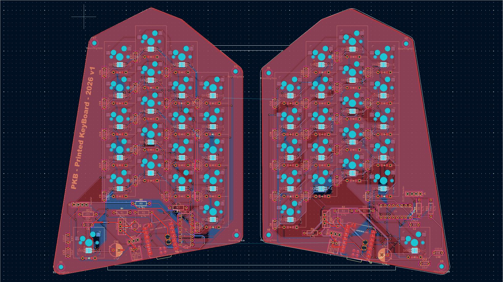
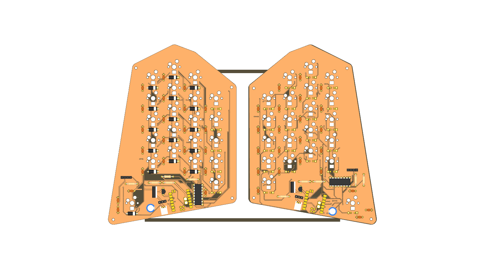
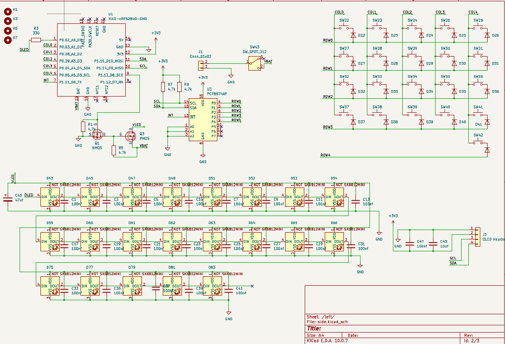
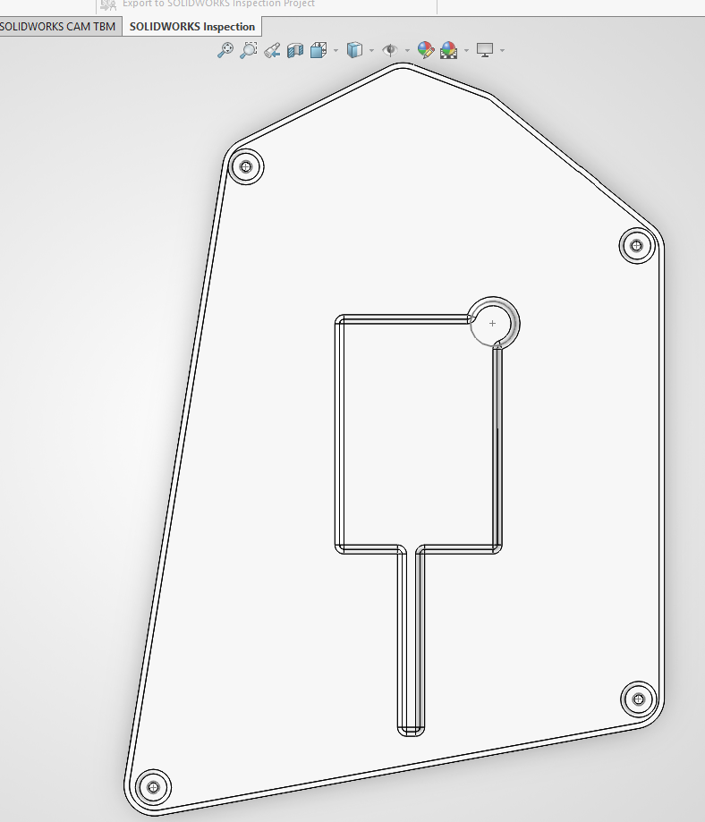
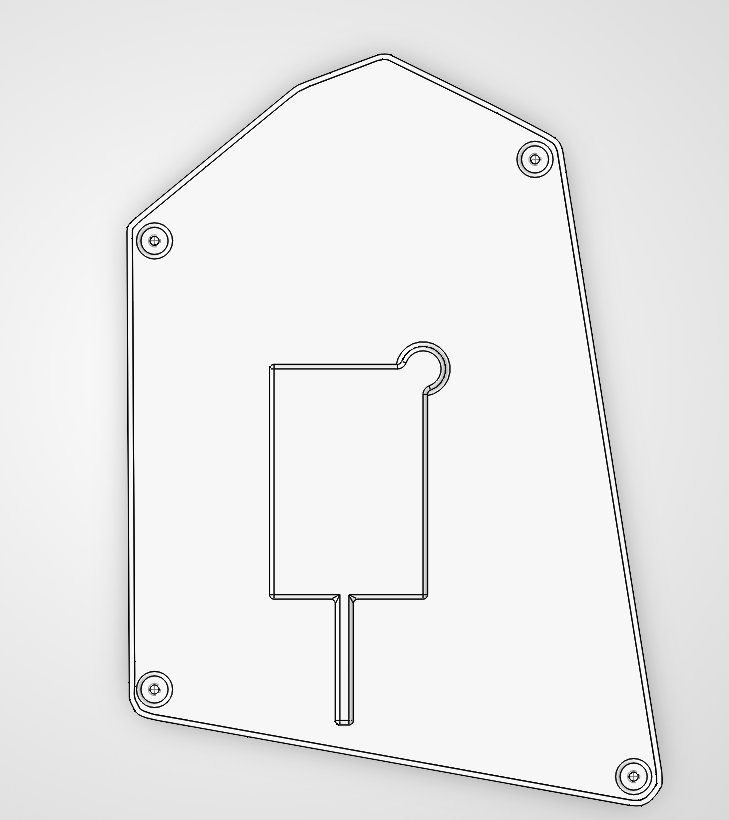

# PKB — Wireless Split Mechanical Keyboard

[](https://kicanvas.org/?repo=https://github.com/huzi-ctrl/split-keyboard/tree/main/kicad)
[](https://github.com/huzi-ctrl/zmk-config-split-keyboard/actions/workflows/build.yml)
[](https://github.com/huzi-ctrl/zmk-config-split-keyboard/releases/latest)

**PKB (Printed KeyBoard)** is a custom 42-key wireless split mechanical keyboard designed from scratch in KiCad 10 and SolidWorks, powered by dual **Seeed Studio XIAO nRF52840** microcontrollers running **ZMK Firmware**.

---

## Why I Made It & How It Works

### Why I Built PKB
Traditional keyboards force your wrists to angle inward and make your fingers stretch across 6+ rows to reach numbers, symbols, and navigation keys. I wanted to design a compact, fully wireless split keyboard where:
1. Each half can be positioned at shoulder width for natural ergonomics.
2. Every letter, symbol, bracket, arrow key, F-key, and Numpad key is within **one row of the home row** using 3 tap-dance layers (**126 effective key bindings** across 42 physical switches).
3. Both halves fit on a **single panelized PCB** connected by mouse-bite breakaway tabs (`BO1`–`BO3`) to make fabrication and assembly clean and cost-effective.

### How It Works
- **Microcontroller & Wireless Split (`Seeed Studio XIAO nRF52840`)**: Each half runs a XIAO nRF52840 (`U1`/`U2`). The left half acts as the central controller (connecting to up to 4 devices over Bluetooth Low Energy or USB-C), while the right half pairs wirelessly over BLE to the left half.
- **I2C GPIO Expansion (`PCF8574AP`)**: Because the XIAO nRF52840 has only 11 GPIO pins, the 5 matrix columns (`COL0`–`COL4`) are driven directly by the XIAO (`D1`–`D5`), while the 5 matrix rows (`ROW0`–`ROW4`) are read through an **NXP PCF8574AP** 8-bit I2C I/O expander (`U3`/`U4`) on a shared I2C bus (`SCL` on `D9`, `SDA` on `D10`).
- **Dual 128×32 OLED Status Displays (`J3`/`J4`)**: Each half includes an I2C SSD1306 128×32 OLED display showing live battery percentage (`%`), active layer name (`QWERTY`, `CODE / NAV`, `NUM / FN`), and USB/Bluetooth profile status, with automatic 30-second idle blanking.
- **Per-Key RGB Underglow (`42× SK6812MINI`) with High-Side MOSFET Power Cut (`Q1`–`Q4`)**: Each half features 21 addressable SK6812MINI LEDs driven by hardware SPI (`D0`) and powered from `VBAT` through an NMOS+PMOS (`Q1`/`Q3`, `Q2`/`Q4`) high-side load switch (`D8`) so LED quiescent draw can be completely cut off to preserve battery life.

---

## PCB & 3D Renders

[](https://kicanvas.org/?repo=https://github.com/huzi-ctrl/split-keyboard/tree/main/kicad)

### Full Panelized PCB Layout (KiCad)


### 3D PCB Render


---

## Schematics

Both the left and right halves share a modular hierarchical schematic (`side.kicad_sch`):

### Left Half Schematic (`/left/`)


### Right Half Schematic (`/right/`)


---

## CAD & Enclosure Design

Custom 3D-printed enclosures modeled in SolidWorks with integrated battery compartment and cable routing channel (available in `.STEP`, `.SLDPRT`, and `.3MF` formats inside [`CAD/`](CAD/)):

| Left Half Enclosure (`left_cad.png`) | Right Half Enclosure (`right_cad.png`) |
| :---: | :---: |
|  |  |

---

## Hardware Pinout

| Function | XIAO nRF52840 Pin | Peripheral / Notes |
| :--- | :--- | :--- |
| **`DLED` (RGB Data)** | `D0` (`P0.02`) | 21× SK6812MINI addressable RGB LEDs per half (`&spi2` MOSI via 330 $\Omega$ resistor) |
| **`COL0` – `COL4`** | `D1` – `D5` (`P0.03`, `P0.28`, `P0.29`, `P0.04`, `P0.05`) | Matrix column outputs (`GPIO_ACTIVE_LOW`, `col2row`) |
| **`INT` (Expander Interrupt)** | `D6` (`P1.11`) | Connected to `PCF8574AP` `/INT` (Pin 13) |
| **`VLED` Power Switch** | `D8` (`P1.13`) | Drives NMOS $\rightarrow$ PMOS high-side switch for `VLED` (`ext-power`) |
| **`SCL` (I2C Clock)** | `D9` (`P1.14`) | `i2c0` (`&xiao_i2c`) with 4.7 k$\Omega$ pull-up to `+3V3` |
| **`SDA` (I2C Data)** | `D10` (`P1.15`) | `i2c0` (`&xiao_i2c`) with 4.7 k$\Omega$ pull-up to `+3V3` |
| **`ROW0` – `ROW4`** | `PCF8574AP` `P0` – `P4` | I2C I/O Expander at address `0x38` (`A0=A1=A2=GND`) |
| **OLED Display (`J3`/`J4`)** | I2C (`SCL`/`SDA`) | 128×32 SSD1306 OLED at address `0x3C` |

---

## Firmware & Keymap (`ZMK`)

Pre-built `.uf2` firmware binaries are automatically compiled by GitHub Actions and published to [**GitHub Releases**](https://github.com/huzi-ctrl/zmk-config-split-keyboard/releases/latest):
- **Left Half (Central):** `pkb_left-seeeduino_xiao_ble-zmk.uf2`
- **Right Half (Peripheral):** `pkb_right-seeeduino_xiao_ble-zmk.uf2`

### Tap-Dance Thumb Keys
- **Left Thumb**: `1 Tap` = **Space** | `2 Taps` = Toggle **Layer 1 (`CODE / NAV`)**
- **Right Thumb**: `1 Tap` = **Backspace** | `2 Taps` = Toggle **Layer 2 (`NUM / FN`)**

### Layer 0: `QWERTY` (Base)
```text
+-----------------------------------------+   +-----------------------------------------+
|   Q   |   W   |   E   |   R   |   T     |   |   Y   |   U   |   I   |   O   |   P     |
|   A   |   S   |   D   |   F   |   G     |   |   H   |   J   |   K   |   L   |   ;     |
|   Z   |   X   |   C   |   V   |   B     |   |   N   |   M   |   ,   |   .   |   /     |
| LCTRL | LSHFT | LALT  | LGUI  |  ESC    |   | RGUI  | RALT  | RSHFT | RCTRL | ENTER   |
+-------------------------------+---------+   +---------+-------------------------------+
                                | SPC/NAV |   | BSP/NUM |
                                +---------+   +---------+
```

### Layer 1: `CODE / NAV` (Double-Tap Left Thumb)
```text
+-----------------------------------------+   +-----------------------------------------+
|   `   |   [   |   ]   |   -   |   =     |   | PG_UP | HOME  |  UP   |  END  |  DEL    |
|   ~   |   {   |   }   |   _   |   +     |   | PG_DN | LEFT  | DOWN  | RIGHT |  ---    |
|  ---  |   \   |   |   |   <   |   >     |   |  ---  |  ---  |  ---  |  ---  |  ---    |
|  ---  |  ---  |  ---  |  ---  |  ---    |   |  ---  |  ---  |  ---  |  ---  |  ---    |
+-------------------------------+---------+   +---------+-------------------------------+
                                | SPC/NAV |   |   ---   |
                                +---------+   +---------+
```

### Layer 2: `NUM / FN` (Double-Tap Right Thumb)
```text
+-----------------------------------------+   +-----------------------------------------+
|  F1   |  F2   |  F3   |  F4   |  F5     |   |   /   |   7   |   8   |   9   |   -     |
|  F6   |  F7   |  F8   |  F9   |  F10    |   |   *   |   4   |   5   |   6   |   +     |
|  F11  |  F12  |RGB_TOG|EP_TOG |OUT_TOG  |   |   0   |   1   |   2   |   3   |   .     |
| BT 1  | BT 2  | BT 3  | BT 4  | BT_CLR  |   |  ---  |  ---  |  ---  |  ---  |  ---    |
+-------------------------------+---------+   +---------+-------------------------------+
                                |   ---   |   | BSP/NUM |
                                +---------+   +---------+
```

---

## Build & Assembly Guide

### Step 1: Depanelize the PCB
1. The left and right keyboard halves are manufactured as a single panel joined by three mouse-bite breakaway tabs (`BO1`, `BO2`, `BO3`) along the center spine.
2. Gently flex or snip along the perforated mouse-bite slots using flush cutters to separate the **Left** and **Right** PCBs, then lightly sand the tab edges flush.

### Step 2: Solder Reverse-Mount RGB LEDs (`D63`–`D104`)
1. Flip the PCB to the **bottom (`B.Cu`)** layer.
2. Solder the 21× **SK6812MINI-E** reverse-mount addressable RGB LEDs per half so their lenses shine upward through the rectangular switch LED cutouts.
   - **Important**: Align the notched/beveled corner (`Pin 3 = GND`) of each SK6812MINI-E with the silkscreen marker on the PCB.
   - Use a temperature-controlled soldering iron at **$280\text{--}300\,^\circ\text{C}$** (or low-temp solder paste + hot air) to avoid overheating the plastic LED packages.

### Step 3: Solder Matrix Diodes (`D1`–`D42`) & SMD MOSFETs (`Q1`–`Q4`)
1. **Matrix Diodes (`D1`–`D42`)**: The `ComboDiode` footprints support either **1N4148W (SOD-123 SMD)** diodes on `F.Cu` or `B.Cu`, or **1N4148 (DO-35 through-hole)** diodes. Orient every diode's cathode band (`|◁`) toward the square pad (`K`).
2. **High-Side LED Power Switch (`Q1`–`Q4`)**: Solder the SOT-23 NMOS (`Q1`, `Q2`) and PMOS (`Q3`, `Q4`) transistors onto their designated SMD pads near the microcontroller area on each half.

### Step 4: Solder Passive Components & IC Expanders (`U3`, `U4`)
1. Solder the **100 nF decoupling capacitors** (`C1`–`C42`) next to each RGB LED, plus the **100 µF bulk radial capacitors** (`C43`, `C44`) across the `VLED` power rails.
2. Solder the axial resistors on each half:
   - **$4.7\text{ k}\Omega$** (`R1`–`R6`): I2C `SDA`/`SCL` pull-ups and `/INT` pull-ups.
   - **$10\text{ k}\Omega$** (`R7`, `R8`) & **$100\text{ k}\Omega$** (`R9`, `R10`): MOSFET gate bias/pull-down resistors.
   - **$330\text{ }\Omega$** (`R11`, `R12`): RGB `DIN` data-line series resistors.
3. Solder the **PCF8574AP** DIP-16 I2C I/O expanders (`U3`, `U4`)—or DIP-16 IC sockets—ensuring the Pin 1 half-moon notch matches the PCB silkscreen.

### Step 5: Solder Hot-Swap Sockets, Switches & Peripherals
1. **Kailh MX Hot-Swap Sockets (`SW1`–`SW42`)**: On the **bottom (`B.Cu`)** side of the PCB, solder all 42 Kailh Choc/MX hot-swap sockets onto their wide SMD pads, making sure they sit flat against the board and do not obstruct the switch center hole.
2. **Seeed Studio XIAO nRF52840 (`U1`, `U2`)**:
   - Before soldering the XIAO down, solder two short wire leads onto the **battery `+` and `-` pads** on the underside of the XIAO nRF52840 and route them to the PCB's battery input pads (`J1`/`J2`) and slide power switch (`SW43`/`SW44`).
   - Solder the XIAO nRF52840 onto the PCB using pin headers or low-profile Mill-Max sockets with the USB-C port facing outward toward the top edge of the board.
3. **128×32 SSD1306 OLED Display (`J3`, `J4`)**: Solder the 4-pin OLED header (`GND`, `VCC`, `SCL`, `SDA`) so the OLED sits above the XIAO footprint.
4. **Slide Power Switch (`SW43`, `SW44`) & LiPo Battery (`J1`, `J2`)**: Solder the 3-pin slide switch and the 2-pin JST-PH 2.0 mm battery connector.

### Step 6: Flash ZMK Firmware & Pair Halves
1. Download the latest `.uf2` files from [**GitHub Releases**](https://github.com/huzi-ctrl/zmk-config-split-keyboard/releases/latest):
   - `pkb_left-seeeduino_xiao_ble-zmk.uf2`
   - `pkb_right-seeeduino_xiao_ble-zmk.uf2`
2. Connect the **Left XIAO nRF52840** to your computer via USB-C and **double-click its onboard Reset button**—it will mount as a removable drive named `XIAO-SENSE`.
3. Drag and drop `pkb_left-seeeduino_xiao_ble-zmk.uf2` onto the drive. Repeat with `pkb_right-seeeduino_xiao_ble-zmk.uf2` on the **Right XIAO nRF52840**.
4. Power both halves on at the same time; they will automatically bond to each other over BLE. Pair your computer or phone to **`PKB`** via Bluetooth!

### Step 7: Final Case Assembly
1. 3D-print [`CAD/3mf/left.3MF`](CAD/3mf/left.3MF) and [`CAD/3mf/right.3MF`](CAD/3mf/right.3MF) in PLA or PETG (`0.2 mm` layer height, 15–20% infill).
2. Place the 3.7 V LiPo battery into the recessed pocket at the base of each printed enclosure and plug it into the JST-PH connector (`J1`/`J2`).
3. Seat the assembled PCB into the enclosure, secure it with M2 screws through the mounting holes, press your 42 MX mechanical switches into the hot-swap sockets, and install your keycaps!

---

## Repository Structure

```text
├── CAD/
│   ├── Keyboard.step          # Full 3D assembly in STEP format
│   ├── 3mf/                   # Printable 3MF files (left.3MF, right.3MF)
│   └── Raw/                   # Native SolidWorks part files (left.SLDPRT, right.SLDPRT)
├── kicad/
│   ├── Keyboard.kicad_pro     # KiCad 10 project file
│   ├── Keyboard.kicad_sch     # Top-level schematic sheet
│   ├── side.kicad_sch         # Left/Right modular keyboard half schematic
│   └── Keyboard.kicad_pcb     # Panelized 2-layer PCB layout
├── firmware/
│   ├── boards/shields/pkb/    # ZMK shield definition, devicetree, Kconfig, and C init
│   ├── config/                # Keymap and ZMK configuration
│   └── build.yaml             # GitHub Actions build matrix
├── images/                    # PCB, schematic, and CAD screenshots
└── production.zip             # Ready-to-manufacture Gerber, Drill, and CPL files
```
